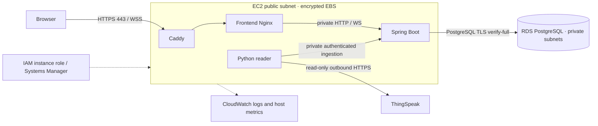

# Manual AWS deployment

Prepared on 22 October 2026. These are instructions for the operator, not a record of an AWS deployment. No AWS resources, public deployment, image publication or Git push were performed by the agent.

## Recommended initial architecture

Use one EC2 instance running Docker Compose, with **private RDS PostgreSQL** and Caddy HTTPS. This keeps the existing application together without adding a load balancer, frontend CDN or container orchestrator. The EC2 instance is a single point of failure; it is appropriate for the initial university prototype, not a highly available monitoring service.



Public URLs use one domain, for example `https://monitor.your-domain.example`. Browser API requests and WebSockets use that same origin. Only Caddy publishes ports. PostgreSQL is never exposed publicly; the backend and frontend have no published host ports. Production Nginx blocks external ingestion endpoints while allowing read APIs and CSV snapshot preparation/downloads.

The dashboard has read-only public APIs and **no end-user login**. If telemetry should be private, initially restrict the EC2 web security-group rules to your viewers' IP ranges. For a private team dashboard, configure Caddy basic authentication or your chosen identity provider before widening access. The ingestion token does not protect public read/export endpoints. This preserves the existing product behavior rather than silently treating the ingestion token as user authentication.

### Services to add

| Service/component | Status for this architecture | Purpose and cost considerations |
|---|---|---|
| EC2 | Required | Runs gateway, frontend, backend and reader. Start with 2 vCPU / 4 GiB or more; this is a sizing starting point, not an AWS benchmark. More memory may be needed while building images. Instance hours, architecture and CPU credit model affect cost. |
| EBS | Required | Encrypted root/application disk, Docker images/logs, persistent Caddy certificate volumes. Start with sufficient space for image builds (for example 30–40 GiB gp3) and monitor usage. Size and snapshots cost money. |
| VPC, subnets, internet gateway, security groups | Required | Public EC2 subnet with internet access; private RDS subnet group across two AZs. Public IPv4 addresses incur charges. This arrangement does not require a NAT gateway for the public EC2 host. |
| IAM instance role | Required for recommended SSM access | Avoid long-lived AWS keys on disk or in containers. Attach only the permissions actually used. |
| RDS PostgreSQL | Required for the supplied production Compose file | PostgreSQL 16, private endpoint, encrypted storage, backups. Single-AZ is the lower-cost initial choice; Multi-AZ adds resilience and cost. Set deletion protection. |
| DNS provider / owned domain | Required for public trusted HTTPS | Existing provider works. Route 53 is optional and charges for hosted zones/queries; domain registration is separate. |
| Caddy container | Included, not a separate AWS service | Automatic certificate issuance and renewal on EC2. ALB and ACM are not needed in this arrangement. Requires correct DNS, open challenge ports and persistent certificate storage. |
| Systems Manager Session Manager | Recommended | Manage EC2 without opening SSH. Instance role and agent/network prerequisites must be satisfied. |
| Parameter Store SecureString | Recommended | Store the deployment env file privately; retrieve on the EC2 host, never into the frontend. Secrets Manager is an alternative with different pricing/rotation features; both are not required. |
| CloudWatch | Recommended | Container logs, host memory/disk metrics and alarms. Ingestion, retention, custom metrics and alarms can generate charges. |
| RDS automated backups / snapshots | Required operationally | Configure retention and test recovery; excess retained backup/snapshot storage costs money. |
| ECR | Optional | Useful for immutable images built elsewhere. Not needed when building from source on EC2. Registry storage/scanning/transfer can cost money. |
| S3 | Optional | Encrypted off-instance logical backups or release archives. The frontend is already served by Nginx, so S3 website hosting is not required. |
| ALB + ACM, ECS/Fargate, CloudFront, WAF | Later options | ECS/Fargate removes host/container scheduling work but introduces task networking, registry, IAM and usually ALB/TLS configuration. Consider it when availability or scaling justifies the complexity and cost. |

Do not assume this is free-tier eligible. Choose a budget and use the current AWS Pricing Calculator for your region. No fixed price estimate is claimed here.

## Operator choices before starting

Supply your AWS account/region, AZs, VPC/subnet IDs, owned domain, DNS provider, certificate contact email, viewer IP ranges, EC2 architecture/type, RDS sizing, backup retention and release tag. Keep EC2 and RDS in the same VPC and region. Pick either x86_64 (for example a T3-class instance) or ARM64 (for example a T4g-class instance); build images for that architecture. An image built on an Apple Silicon Mac is not automatically an x86_64 deployment image.

## 1. Networking and EC2

In the AWS console:

1. Use/create a VPC with DNS support and DNS hostnames enabled. Create one public app subnet whose route table has `0.0.0.0/0` to an internet gateway. Create private DB subnets in two AZs for the RDS subnet group. RDS itself does not need a public IP or NAT to accept private EC2 connections.
2. Create `agecm-web` security group. Allow inbound TCP 80 and 443 for the intended audience; HTTP ACME validation must be reachable if using Caddy's HTTP challenge. For a public site allow the intended public access. For a private prototype, keep TCP 80 publicly reachable for HTTP certificate validation and restrict TCP 443 to viewer IP ranges; otherwise use a separately configured DNS certificate challenge. Restricting both challenge ports to viewers prevents public certificate validation. Do not open 8080, 5173 or 5432. Prefer SSM access and no SSH rule. If SSH is necessary, allow port 22 only from your current operator IP.
3. Create `agecm-db` security group with inbound TCP 5432 **from the agecm-web security group**, not a public CIDR. Allow the EC2 host outbound HTTPS 443 to ThingSpeak, image/package registries, certificate issuers and AWS management endpoints, TCP 5432 to the DB group, and required DNS/time traffic. The default outbound allow-all rule is a simpler initial option; do not restrict outbound HTTPS solely to AWS IP ranges because ThingSpeak is external.
4. Launch a current Amazon Linux 2023 EC2 AMI of the chosen architecture with encrypted EBS, IMDSv2 required, the web security group and an instance profile. Allocate/associate a stable public IPv4 address if the DNS record will point directly to it. Account for its cost.
5. Use an instance role with `AmazonSSMManagedInstanceCore` for Session Manager. Add `CloudWatchAgentServerPolicy` only if installing the agent. For the env SecureString, adapt `deploy/ssm-parameter-policy.example.json` to the exact account/region/path. Add narrowly scoped KMS decrypt permission if using a customer-managed key. Application containers do not need AWS API permissions or static AWS credentials.

[AWS security groups](https://docs.aws.amazon.com/vpc/latest/userguide/vpc-security-groups.html) control resource ingress/egress. [Session Manager instance permissions](https://docs.aws.amazon.com/systems-manager/latest/userguide/session-manager-getting-started-instance-profile.html) describe the instance-role requirements.

## 2. Install Docker and obtain the source

On EC2 through Session Manager:

```bash
sudo dnf update -y
sudo dnf install -y docker git
sudo systemctl enable --now docker
sudo usermod -aG docker ec2-user
```

Reconnect before using Docker without sudo. Membership in the Docker group grants host-level control; limit it to the operator.

Install the Docker Compose CLI plugin using [Docker's official Linux plugin installation instructions](https://docs.docker.com/compose/install/linux/). Select the download matching the EC2 CPU architecture and verify the published checksum. Then verify:

```bash
docker version
docker compose version
```

Copy a reviewed source release, including the current uncommitted changes, to a directory such as `/opt/agecm/AGECM_Revised`, owned by the deployment operator. Do **not** assume cloning GitHub will include these local changes. Use your approved private transfer mechanism; exclude `.env`, `.env.production`, `.runtime`, node_modules, target, dist, private PDFs/attachments and local exports/backups. Do not use a public S3 bucket. This guide does not authorize a Git push or file upload by the agent.

AWS's [Docker-on-EC2 instructions](https://docs.aws.amazon.com/AmazonECS/latest/developerguide/create-container-image.html) cover the Docker Engine setup and the optional ECR path.

## 3. Create private RDS PostgreSQL

In RDS create PostgreSQL **16** with initial database `agecm_revised`, encrypted storage, the private DB subnet group, the DB security group, **Public access = No**, deletion protection, storage monitoring/autoscaling appropriate to your budget, and automated backup retention (for example 7 days). Keep master/admin credentials outside application containers.

Download the public RDS CA bundle into the project:

```bash
cd /opt/agecm/AGECM_Revised
mkdir -p deploy/certs
curl --fail --show-error --silent --location \
  https://truststore.pki.rds.amazonaws.com/global/global-bundle.pem \
  --output deploy/certs/global-bundle.pem
```

This public certificate bundle is ignored by Git. The backend uses `sslmode=verify-full` and verifies both chain and endpoint hostname. Do not change to `require`, `disable`, or an IP address to work around certificate errors. See [RDS PostgreSQL SSL configuration](https://docs.aws.amazon.com/AmazonRDS/latest/UserGuide/PostgreSQL.Concepts.General.SSL.html).

Using an installed PostgreSQL 16 client on EC2 (or an operator PostgreSQL client container with the CA mounted), connect as the RDS admin with password prompting:

```bash
psql "host=YOUR_RDS_ENDPOINT port=5432 dbname=agecm_revised user=YOUR_ADMIN sslmode=verify-full sslrootcert=deploy/certs/global-bundle.pem" -W
```

In psql:

```sql
CREATE ROLE agecm_app LOGIN;
\password agecm_app
GRANT CONNECT ON DATABASE agecm_revised TO agecm_app;
GRANT USAGE, CREATE ON SCHEMA public TO agecm_app;
```

The app needs permission to create/manage its own schema objects for Flyway. Do not grant RDS superuser capabilities. If separating migration and runtime identities later, configure a separate Flyway user and test its privileges before deployment.

### Preserve current local history

Choose deliberately whether AWS starts with an empty database or receives the existing history. To migrate existing data, stop only the **local processing service** during the final backup to avoid a cutover gap. The hardware may continue uploading to ThingSpeak; the cloud reader catches up after AWS starts within its readable history limits.

From the local project:

```bash
umask 077
docker compose -p agecm_revised -f compose.yaml stop processing
docker compose -p agecm_revised -f compose.yaml exec -T postgres \
  pg_dump -U agecm_revised -d agecm_revised -Fc > agecm-cutover.dump
```

Transfer the private dump through your approved secure channel. Restore it into a **new empty target database before starting the backend**, as `agecm_app`, using PostgreSQL 16 `pg_restore --no-owner --no-privileges --exit-on-error` and verified TLS. Use a mode-0600 PGPASSFILE or an interactive password prompt; never include a password in a URL or command argument. Preserve the Flyway table and ingestion-state records. Do not use `--clean` on the existing local database or an occupied target.

After restoring, compare counts and latest full cloud identities, then start AWS processing. If aborting the cutover, restart local processing with `docker compose -p agecm_revised -f compose.yaml start processing`. Do not operate two independent readers against a single shared database during migration. A restored Flyway history is validated on startup; migrations are not rerun destructively.

## 4. Configure private deployment values

```bash
cp .env.production.example .env.production
chmod 600 .env.production
```

Edit every placeholder privately. `PUBLIC_DOMAIN` is a DNS hostname without `https://` or a trailing slash. Generate a separate random ingestion token, for example with `openssl rand -hex 32`. Use the app DB user's password, not the RDS admin password. Shell-special values in dotenv must be quoted correctly; do not source the dotenv file as a shell script. Keep production secrets distinct from local development.

| Variable | Value |
|---|---|
| IMAGE_TAG | Unique immutable release label, e.g. release-20261022-01 |
| PUBLIC_DOMAIN | Owned DNS hostname pointing to EC2 |
| ACME_EMAIL | Operator email for TLS account contact |
| DB_HOST | Actual RDS DNS endpoint, without protocol or port |
| DB_NAME / DB_USER / DB_PASSWORD | Target DB, application role and private password (at least 16 characters for supplied guard) |
| INGESTION_TOKEN | Random private token, at least 32 characters, same for backend and reader |
| THINGSPEAK_NODE1_CHANNEL_ID / NODE2_CHANNEL_ID | Actual numeric channel IDs |
| THINGSPEAK_NODE1_READ_KEY / NODE2_READ_KEY | Private Read API keys; no Write keys required |
| REPORT_INTERVAL_SECONDS | 20 for the confirmed firmware |
| CLOUD_POLL_SECONDS | 5 by default |
| STALE_SECONDS | 65 by default; stale describes measurement age, not poll success |

Compose fixes production mode to LIVE, the real ThingSpeak HTTPS endpoint, and the HTTPS origin. Production guards reject development secrets, mock mode and unverified DB TLS. No VITE variable contains a credential. Docker administrators can inspect container environment values; restrict host access accordingly.

Recommended: store the completed dotenv content as `/agecm/production/env`, a Parameter Store **SecureString**. The operator retrieves it on EC2 with the instance role:

```bash
umask 077
aws ssm get-parameter --name /agecm/production/env --with-decryption \
  --query Parameter.Value --output text > .env.production
chmod 600 .env.production
```

Do not run Compose `config` without `--quiet` in shared terminals/logs: resolved configuration contains secrets. Rotating env values requires recreating the relevant containers.

## 5. DNS, TLS and startup

Create an A record for `PUBLIC_DOMAIN` pointing to EC2's stable public IPv4 address. Use an AAAA record only when IPv6 routing/security is actually configured. Ensure Caddy can reach certificate issuers and that inbound validation traffic can reach the host. Caddy stores certificates/accounts in named volumes and automatically renews them; preserve those volumes. [Caddy's HTTPS prerequisites](https://caddyserver.com/docs/automatic-https) document DNS, ports and storage requirements.

Use the standalone production file, **not an override merged into the local Compose file**:

```bash
docker compose --env-file .env.production -f compose.production.yaml config --quiet
docker compose --env-file .env.production -f compose.production.yaml build backend frontend processing
docker compose --env-file .env.production -f compose.production.yaml up -d --no-build --wait
docker compose --env-file .env.production -f compose.production.yaml ps
```

Build on EC2 for its native architecture. For a small instance, build/push matching architecture images to private ECR from a build host instead; adapting image names to your registry is an operator step. Use immutable tags/digests and never overwrite a release tag. No image push was performed here.

Production runtime limits reserve roughly 2.2 GiB across containers, plus the host, Docker and building overhead. Confirm capacity with real traffic. Temporary CSV snapshots use backend `/tmp` (384 MiB tmpfs), expire after 5 minutes, have a 128 MiB per-file limit, and do not consume browser memory for the full CSV. Limits are explicit errors rather than silent truncation. A restart invalidates outstanding download links; users prepare another export.

## 6. Verification after manual AWS deployment

1. `https://YOUR_DOMAIN/` loads with a trusted certificate; HTTP redirects to HTTPS. Check all five routes and image loading.
2. `/api/health` and `/api/system/status` show the expected LIVE source, correct channel configuration and real DB connection. External `/api/ingestion/node_01`, POST `/api/telemetry` and POST `/api/integration/status` are blocked by production Nginx.
3. Wait for a new physical upload. Compare channel ID, entry ID, **cloud creation timestamp**, all eight fields and raw distance against ThingSpeak and RDS. A reused numeric ID is not sufficient identity. Nulls, sensor faults and -1 must remain truthful.
4. Confirm WebSocket uses `wss://YOUR_DOMAIN/ws`, telemetry arrives after DB commit, and REST updates continue if WS disconnects. No localhost URLs should appear in browser network requests.
5. Export Node 01, Node 02 and Comparison for selected ranges; parse the files and compare their identities/values to the API/database. Export again after a new physical reading without reloading the page. The file includes a fresh server cutoff and all eligible rows, not just the chart page.
6. Restart the reader and backend; verify durable cursors, no full-identity duplicates and preserved history. Production Nginx resolves changed backend IPs through Docker DNS.
7. Test an isolated backup restore before relying on backups. Record the restore time and verification results.

## Logs, alarms and backups

- Application logs go to stdout. Compose rotates each container's JSON logs at 10 MiB × 3 files. Caddy/Nginx access logging is disabled to avoid persisting temporary export capability URLs. Reader errors redact credential-bearing cloud URLs. Do not enable debug HTTP/client wire logging with production keys.
- `docker compose --env-file .env.production -f compose.production.yaml logs --tail=100 backend processing frontend gateway` shows service errors. Do not print `.env.production` or `docker inspect` environments in tickets.
- Optional CloudWatch agent: install the official agent on EC2 with the instance role, create `/agecm/production` log group with a chosen retention (for example 7 days), copy `deploy/cloudwatch-agent.json` to the agent config, and start it using the official agent control command. The sample sends Docker JSON logs and host memory/disk utilization. Check the default Docker data directory first; adapt paths if changed. Create alarms for EC2 status checks, sustained CPU, memory, disk and RDS storage/connections. Configure a notification destination manually. CloudWatch host health alone does not prove recent sensor uploads; inspect node age/cloud errors separately or add a dedicated freshness metric.
- Enable RDS automated backup retention and take a manual snapshot before schema/release changes. [RDS backups](https://docs.aws.amazon.com/AmazonRDS/latest/UserGuide/USER_WorkingWithAutomatedBackups.html) support point-in-time recovery within retention. Restoring creates a new DB instance: keep it private, set its SG/subnet settings, update `DB_HOST` and recreate backend/processing after checking the restored data.
- For logical backups, run PostgreSQL 16 `pg_dump -Fc` through verified TLS using a private PGPASSFILE. Encrypt local backup storage and transfer off-instance to a private encrypted destination if required. Never store dumps in Git or a web-served folder. Restore with `pg_restore --no-owner --no-privileges --exit-on-error` into a new empty DB and compare counts, Flyway history and newest full cloud identities. The local project backup taken during verification is not an AWS backup.

## Updates and rollback

1. Take an RDS snapshot and a logical backup. Save the current release manifest/tag and private env configuration separately. Retain the prior Docker images.
2. Review/test the release and its Flyway migrations. Change `IMAGE_TAG` to a new unique tag, build or pull matching architecture images, then run `up -d --no-build --wait` with the production file. Follow the verification steps.
3. For an application-only rollback with a compatible schema, restore the previous reviewed source/config and previous image tag, then recreate services without rebuilding that tag. Do not assume Compose image tags alone roll back bind-mounted config/source files.
4. For a schema-incompatible rollback, stop the reader, restore the pre-release RDS snapshot to a **new** DB instance, use its endpoint with the previous release, verify data, then resume ingestion. Account for observations after the snapshot and perform bounded reconciliation; do not lower cursors blindly. Never delete the original DB during recovery.
5. Do not run `down -v`, `docker volume prune`, `flyway clean`, database resets, or broad container cleanup. Plain service recreation preserves the managed DB and Caddy certificate volumes.

## Troubleshooting

| Symptom | Check |
|---|---|
| 502 / backend unhealthy | RDS endpoint, SG source group, credentials, CA mount, verified TLS and Flyway logs. Do not weaken SSL. |
| TLS issuance fails | Domain ownership, A/AAAA records, reachable 80/443, issuer outbound access, persistent writable Caddy volumes. Do not bypass browser certificate warnings. |
| WS fails but REST works | Same HTTPS origin, WSS URL, Nginx upgrade headers, idle timeout, domain setting; no development hostnames. |
| Poll HEALTHY but node STALE | ThingSpeak's newest cloud timestamp and actual hardware uploads. Poll success does not prove fresh measurements. |
| CSV 429/503 | Concurrent/prepared export capacity, backend tmpfs usage, database query/disk/network errors. Retry or use a shorter range; never substitute a cached download. |
| CSV link 410 | Its 5-minute lifetime expired or backend restarted; prepare a new snapshot. |
| Charts and CSV row counts differ | Charts intentionally show at most 1,000 newest rows per node; CSV covers all matching rows at its cutoff. |
| Channel entries skipped / reused IDs | Confirm full identities and ID/time watermarks. Preserve timestamp-aware deduplication; inspect GAP errors and readable history bounds. |

## Validation boundary

Compose parsing, local production guard tests, application tests, Docker builds and proxy configuration validation can be checked locally. Actual RDS IAM/TLS/connectivity, public DNS/certificate issuance, AWS instance sizing, CloudWatch collection/alarms, account permissions, charges and AWS recovery must be verified by the operator after manual deployment. See [CSV and hosting validation](csv-aws-validation.md) for completed local evidence.

### Optional operator backup helper

After configuring `.env.production` and the CA bundle on EC2, use:

```bash
python3 scripts/production_db.py backup agecm-release-backup.dump
```

The helper uses the resolved production connection values privately, passes credentials through a temporary mode-0600 client env file, runs the PostgreSQL 16 client with verified TLS, refuses to overwrite an existing backup, and removes an incomplete backup on failure. No AWS access keys are used. For a restore, first configure `.env.production` to point at a **new empty target database**, keep backend/processing stopped for that target, then run:

```bash
python3 scripts/production_db.py restore agecm-release-backup.dump
```

Restore refuses a target with any public tables. It never drops an existing schema. A failed restore can leave partially restored objects in the new target; discard/recreate that new target through your normal operator procedure rather than rerunning against occupied production data. RDS execution of this helper remains part of manual AWS verification; no production DB credentials were supplied or used by the agent.


### Example Compose plugin install on Amazon Linux 2023

The official Docker documentation currently illustrates Compose v5.6.0. Review the release/checksum before using it and substitute an approved newer version when appropriate. On EC2, after Docker is installed:

```bash
taskComposeVersion=v5.6.0
taskComposeArch=$(uname -m)
mkdir -p .runtime/compose-install
curl --fail --show-error --silent --location \
  "https://github.com/docker/compose/releases/download/${taskComposeVersion}/docker-compose-linux-${taskComposeArch}" \
  --output .runtime/compose-install/docker-compose
curl --fail --show-error --silent --location \
  "https://github.com/docker/compose/releases/download/${taskComposeVersion}/docker-compose-linux-${taskComposeArch}.sha256" \
  --output .runtime/compose-install/docker-compose.sha256
python3 - <<'PY_CHECK'
import hashlib
from pathlib import Path
folder=Path('.runtime/compose-install')
expected=(folder/'docker-compose.sha256').read_text().split()[0]
assert hashlib.sha256((folder/'docker-compose').read_bytes()).hexdigest()==expected, 'Checksum mismatch'
PY_CHECK
sudo install -d /usr/local/lib/docker/cli-plugins
sudo install -m 0755 .runtime/compose-install/docker-compose /usr/local/lib/docker/cli-plugins/docker-compose
docker compose version
```

Both downloads must come from the reviewed official release. A manually installed plugin must be updated manually. These Linux commands are instructions for the EC2 operator; they were not run on the local Mac.

### Example CloudWatch agent startup on EC2

After setting the instance-role permissions and creating the log group/retention in the console:

```bash
sudo dnf install -y amazon-cloudwatch-agent
sudo cp deploy/cloudwatch-agent.json /opt/aws/amazon-cloudwatch-agent/etc/amazon-cloudwatch-agent.json
sudo /opt/aws/amazon-cloudwatch-agent/bin/amazon-cloudwatch-agent-ctl \
  -a fetch-config -m ec2 -s \
  -c file:/opt/aws/amazon-cloudwatch-agent/etc/amazon-cloudwatch-agent.json
```

See the [official agent startup command](https://docs.aws.amazon.com/AmazonCloudWatch/latest/monitoring/start-CloudWatch-Agent-on-premise-SSM-onprem.html). Verify logs and metrics actually arrive in your selected region before adding alarms. This was not executed against AWS.
